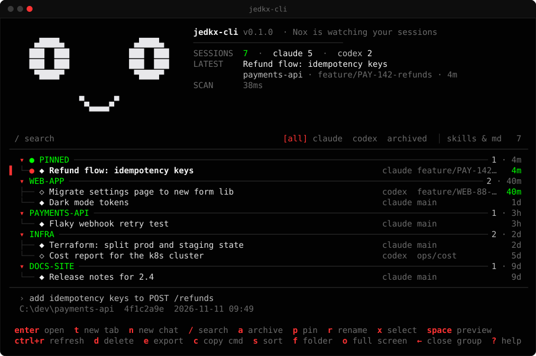
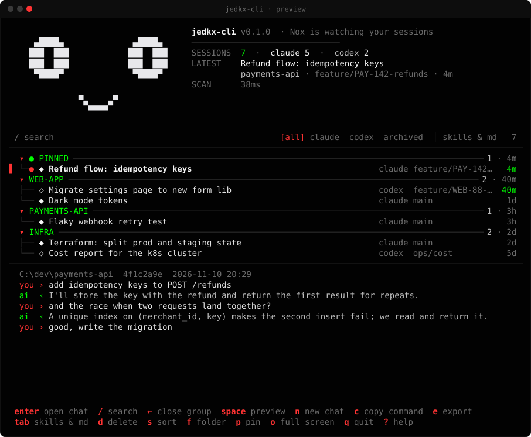
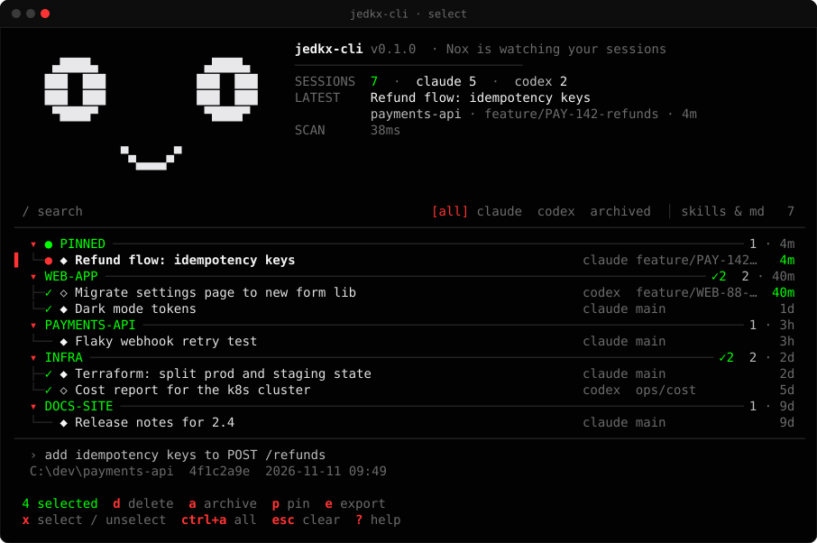
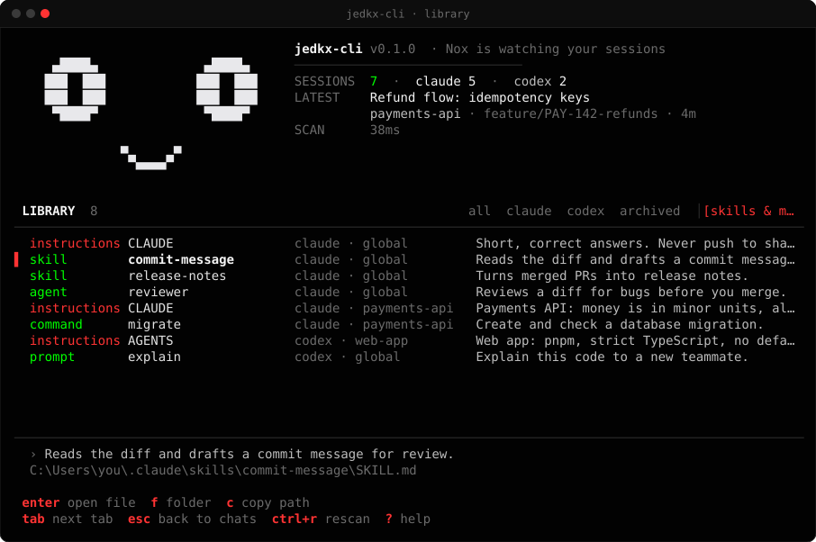
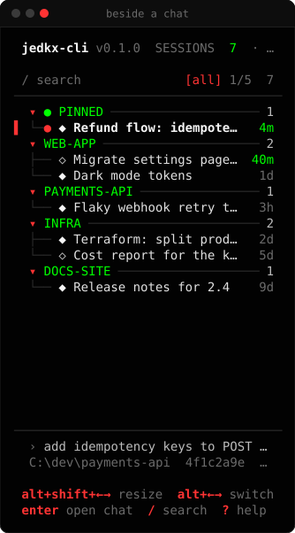
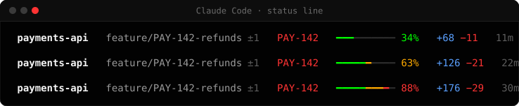
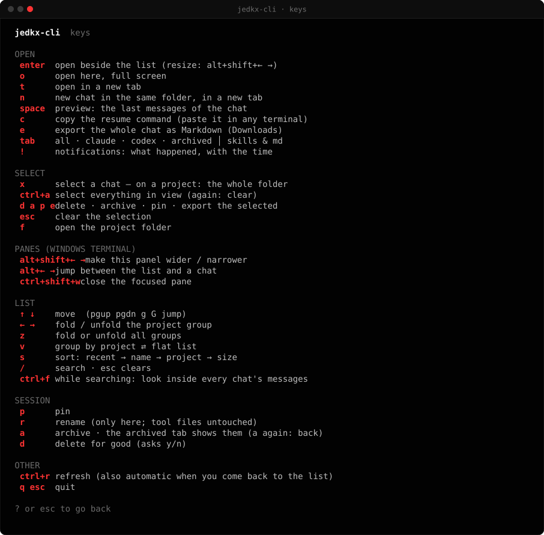

# jedkx-cli

A terminal app that lists every Claude Code and Codex chat on your machine and lets you jump back into one.



I use Claude Code and Codex across a lot of folders, and `--resume` only shows the chats of the folder
you're in. After a while I couldn't find anything, so I wrote this: one list, grouped by project,
with search. Press Enter and the chat opens next to the list.

It doesn't keep a copy of your chats. It reads the files the tools already write
(`~/.claude/projects`, `~/.codex/sessions`) and runs `claude --resume <id>` or `codex resume <id>`
in the right folder. The only thing it stores is your own names, pins and archive.

## Features

- Claude Code and Codex chats in one list, grouped by project, pinned ones on top
- Open a chat beside the list (`enter`), full screen (`o`) or in a new tab (`t`); `n` starts a new chat in that folder, in a new tab
- A chat that is already open is not opened twice: `enter` / `t` switches to its tab
- Search titles, first prompts, folders and branches; `ctrl+f` searches inside the chats too
- Preview the last few messages with `space`
- Rename, pin, archive, delete; select several (`x`, `ctrl+a`) and act on all of them
- Export a chat to Markdown (`e`), copy its resume command (`c`), open its folder (`f`)
- A **skills & md** tab with your skills, agents, commands and `CLAUDE.md` / `AGENTS.md` files
- `jedkx-cli stats` for token use per day (Claude Code)
- A Claude Code status line
- Which account Claude Code and Codex are signed in with, shown quietly in the list header and the status line
- Optional: my Claude Code theme and a Windows Terminal profile (see [Setup](#setup))

Big log files are never read whole: only the start and end of each file, and unchanged files are
cached, so a few hundred chats load in about 0.1 s.

## Screenshots

Rendered from the real UI with fake data (`internal/ui/shots_test.go`).

Preview of the selected chat:



Selecting a whole folder:



Skills and instruction files:



As a narrow pane next to a chat:



The status line (folder, branch, context use, lines changed, model):



Keys (`?`):



## Install

**Windows:** download `jedkx-cli_windows_amd64.exe` from
[Releases](https://github.com/jedkx/jedkx-cli/releases/latest) and run it. It asks what to install
(one number, or several like `2 4`):

| Choice | Lists | Also changes |
|---|---|---|
| everything | Claude Code + Codex | Claude Code theme, Windows Terminal profile |
| Claude only | Claude Code | Claude Code theme |
| Codex only | Codex | nothing |
| terminal only | both | Windows Terminal profile |
| just the app | both | nothing |

Before changing any settings file it copies it into a backup folder next to the exe. If it's already
installed, the same exe offers to update or uninstall it.

**PowerShell / shell:**

```powershell
irm https://raw.githubusercontent.com/jedkx/jedkx-cli/main/scripts/install.ps1 | iex
```

```sh
curl -fsSL https://raw.githubusercontent.com/jedkx/jedkx-cli/main/scripts/install.sh | sh
```

No admin or sudo needed. Downloads are checked against the release's SHA-256 checksums.
Open a new terminal and run `jedkx-cli`.

## Usage

```
jedkx-cli                     the chat list
jedkx-cli .                   only chats from this folder
jedkx-cli last                continue the latest chat in this folder
jedkx-cli stats [--days 7]    token use per day
jedkx-cli sessions [query]    print chats (--json, --tool claude|codex, --all)
jedkx-cli clean               free disk: caches, snapshots, file history (--older 30: old chats)
jedkx-cli plugins             Claude Code plugins and MCP servers (enable|disable|update|remove <id>)
jedkx-cli login [codex]       sign in with another account
jedkx-cli setup               theme and terminal profile (--only claude|terminal, --undo)
jedkx-cli config [key [on|off]]   update.check, update.auto, animation, claude, codex
jedkx-cli update [--check]    install the latest release
jedkx-cli uninstall           remove it (--dry-run, --purge, --yes)
```

| Key | Action |
|---|---|
| `enter` | open beside the list (Windows Terminal / tmux); on a project: fold / unfold |
| `o` `t` `n` | full screen, new tab, new chat in the same folder (new tab) |
| `space` `s` | preview, change sort |
| `/` `ctrl+f` | search, search inside chats |
| `←` `→` `z` `v` | fold / unfold, fold all, flat list |
| `x` `ctrl+a` | select, select all |
| `p` `r` `a` | pin, rename, archive (`a` in the archived tab brings it back) |
| `c` `f` `e` | copy resume command, open folder, export to Markdown |
| `d` | delete the chat's files (asks first) |
| `tab` | all, claude, codex, archived, skills & md |
| `!` | notifications: what happened, with the time |
| `ctrl+r` `?` `q` | refresh chats + check for an update (chats also when you come back), help, quit |

## Setup

`jedkx-cli setup` is optional. It sets:

- **Claude Code:** a `jedkx` theme, the status line, spinner words and tips, and (Windows) a grey tab
  per project so tabs of different projects are told apart; a tab turns dark red when its chat has
  finished and waits for you
  (in `~/.claude/settings.json`, other keys left as they are)
- **Windows Terminal:** a `jedkx-cli` profile (PowerShell in the jedkx colours) and a grey tab theme.
  Your profiles and your default profile stay as they are; to open new terminals in the jedkx look,
  pick it yourself: Settings › Startup › Default profile → jedkx-cli. Type `jedkx-cli` there for the list.

`jedkx-cli setup --undo` (and uninstall) puts the old values back. If you changed one of them yourself
after setup, undo leaves your value alone.

Only want the status line?

```json
"statusLine": { "type": "command", "command": "jedkx-cli statusline" }
```

## Uninstall

```
jedkx-cli uninstall --dry-run     # show what would be removed
jedkx-cli uninstall
```

or Settings › Apps › jedkx-cli. Install writes down everything it adds; uninstall removes exactly that:
the program folder, its user PATH entry, the Apps entry, the cache and the setup changes.
Your names and pins are only deleted if you say so (or pass `--purge`).

## Privacy

No telemetry or account. Chats are only read on your machine. The signed-in e-mail is read from `~/.claude.json` and `~/.codex/auth.json` only to show it; tokens are never kept. The only network call is to GitHub to
check for a new release (turn off with `jedkx-cli config update.check off`, or keep the check and stop
auto-download with `update.auto off`).

## Development

Go 1.27, Bubble Tea and Lip Gloss.

```sh
go test ./...
go build -trimpath -ldflags "-s -w" ./cmd/jedkx-cli
JEDKX_SHOTS=docs/screenshots go test ./internal/ui -run TestScreenshots -count=1   # screenshots
```

```
cmd/jedkx-cli        entry point, installer, subcommands
internal/source      reading sessions (claude/, codex/), cache
internal/catalog     scan, merge, search, sort
internal/meta        names, pins, archive
internal/library     skills and instruction files
internal/ui          the TUI
internal/statusline  Claude Code status line
internal/setup       theme / terminal profile and undo
internal/update      release check and self-update
internal/install     install / uninstall
```

Adding another tool means one package implementing `source.Adapter` and one line in `catalog.Adapters()`.
Platform notes: [`docs/PLATFORMS.md`](docs/PLATFORMS.md).

Releases are built by GoReleaser when a `v*` tag is pushed.

Codex token stats aren't there yet; the Codex logs I had didn't contain usage data.

## License

MIT, Caner Coşkun. Claude Code and Codex belong to their makers; this only reads their files.
